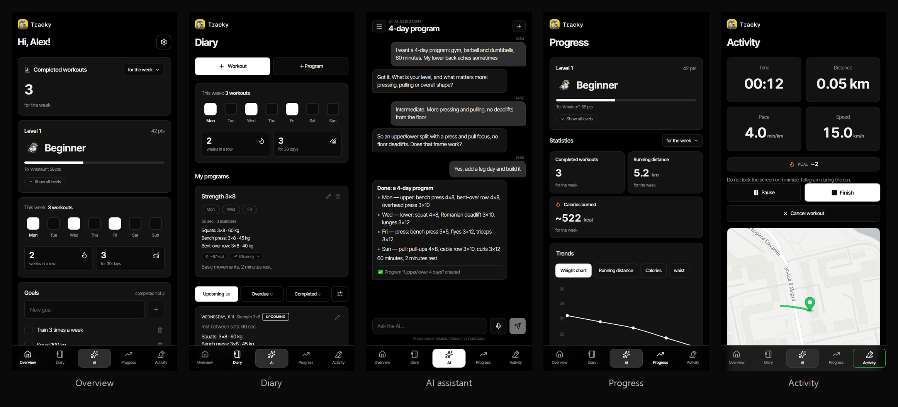

  

<h1 align="center">Tracky — your training log in Telegram</h1>

  <b>Workouts, programs, progress and runs in one bot. No spreadsheets, no notes, no dozen apps.</b>

  <a href="https://t.me/AiTrackyBot"><b>Open in Telegram</b></a>
  &nbsp;·&nbsp;
  <a href="https://ivanburenin.github.io/tracky-ai/">Landing page</a>

  

## What is Tracky

Tracky is a Telegram bot with a Mini App for people who train and run. It opens
right inside Telegram: nothing to install, no separate account to create.

You log your sets and body weight, and Tracky calculates volume, calories and
progress and turns it into clear charts. You can build a training program
manually or ask the AI to create one for your level, equipment and goals.

## What it does

### 📓 Workout diary
- Log sets: exercise, weight, reps, rest.
- Ready-made programs for 1–7 training days a week, with exercises and weights.
- Workout statuses: upcoming, overdue, completed.
- Notes for every workout and calorie estimates.

### 🏋️ Programs
- Your own programs for the gym, home or outdoors.
- Programs by weekday: every session knows its exercises and weights.
- Edit and duplicate programs.

### 🤖 AI assistant
Describe your goal in plain words — “a 4-day program, gym, barbell and
dumbbells, 60 minutes, my lower back acts up sometimes” — and the AI builds it.
It asks for what is missing and shows what exactly it is going to create.

The assistant can:
- create and change training programs;
- add workouts and exercises;
- set and change body weight and goals;
- answer questions about your training and progress.

It works both in the bot and in the app, with one shared conversation history.
In the app you can also dictate requests with your voice instead of typing.

### 📈 Progress
- Completed workouts for the week, month and all time.
- Running distance and burned calories.
- Charts: weight, distance, calories, waist.
- Body measurements and goals with completion marks.
- Levels and points: from “Novice” onward, earned for consistency.

### 🏃 Runs
- GPS tracker right in the app: time, distance, pace, speed, calories.
- Your route on the map.
- Every run is saved to the diary and counts toward your progress.

## Languages

The bot and the app speak six languages:

🇬🇧 English · 🇷🇺 Russian · 🇩🇪 German · 🇫🇷 French · 🇪🇸 Spanish · 🇨🇳 Chinese

The language follows your Telegram settings and can be changed in your profile.

## Get started

1. Open the bot: **[t.me/AiTrackyBot](https://t.me/AiTrackyBot)**.
2. Tap “Start” — the bot briefly asks about your goal and training level.
3. Log your first workout, or ask the AI to build a program.

Everything else stays in one place: the bot sends reminders, and the app opens
with a button in the bot.

## FAQ

**Do I need to install anything?**
No. Everything runs in Telegram. The app opens with a button in the bot.

**Where is my data stored?**
On Tracky's servers. Your weight, measurements and routes are visible only to you.

**Does a run keep tracking with the screen off?**
No. The Telegram app runs inside a WebView, and a WebView does not execute code
in the background. During a run, keep the screen on — the app keeps it awake by
itself. Honest background tracking would require a separate native app.

**Can I export my history?**
CSV export is on the roadmap.

**Is this open source?**
No. Tracky is a commercial product and the source code is closed.

---

  <a href="https://t.me/AiTrackyBot"><b>Open Tracky in Telegram →</b></a>

